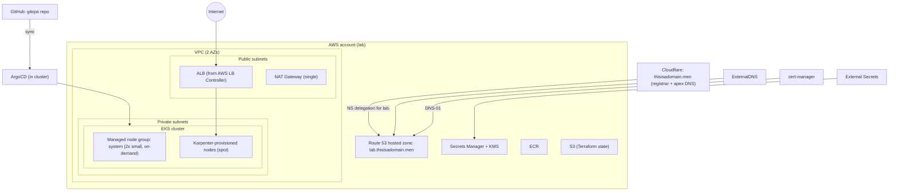

# EKS Production Lab — Project Plan

> **Purpose:** Close the "no production Kubernetes" gap by building, operating, upgrading, and deliberately breaking a production-shaped EKS platform, then documenting it well enough to talk through in an interview.
>
> **What this is not:** a claim of production experience. It's evidence that you've hit the problems production Kubernetes engineers deal with, and that you handle them in a disciplined, production-like way.

---

## 1. Outcomes

By the end, the repo should contain these artifacts. Interviewers care about these, not the cluster itself:

| Artifact | Why it matters |
|---|---|
| Terraform for VPC + EKS + IAM, reproducible from zero | Shows IaC discipline and AWS depth (your existing strength) |
| GitOps repo (ArgoCD app-of-apps) managing all platform add-ons and the demo app | Shows how real platform teams operate clusters |
| **Upgrade log**: one full EKS minor-version upgrade, step by step | The most common gap production interviewers probe |
| **6–8 postmortems** from induced failures | Shows you can talk about incidents with depth |
| Runbooks (spin-up, teardown, node drain, rollback, upgrade) | Shows operational maturity |
| Architecture diagram + ADRs (decision records) | Shows you can justify trade-offs |
| Triage agent run against real EKS failures | Ties your two side projects into one story |

---

## 2. Guiding principles

1. **Ephemeral by default.** The cluster exists only during work sessions. Everything must come back with `terraform apply` + ArgoCD sync, with no manual clicks.
2. **Everything as code.** If you did something in the console, it didn't happen. Write it down, then codify it.
3. **Ops over build.** Spend at least half the total time on Phases 5–6 (day-2 ops and failure drills). That's the production experience part.
4. **Write it down while it's fresh.** Postmortems and the upgrade log get written the same session, not later.
5. **The app keeps its own repo.** The demo app (`kind-api`) stays in `nodejs_with_kind`, which owns its source, image build and manifests. EKS gets a new `overlays/eks/` there, next to `dev` and `prod`. The platform gitops repo only holds the ArgoCD `Application` that points at that overlay. Don't copy the app's manifests into the platform repo.

---

## 3. Architecture



**Key design choices (write ADRs for each):**

- **System node group + Karpenter.** A small managed node group runs ArgoCD, Karpenter, CoreDNS, and controllers (this avoids the problem of Karpenter needing a node to run on). App workloads land on Karpenter spot nodes.
- **EKS Pod Identity as default, IRSA for one controller.** Pod Identity is the newer approach. Using IRSA for one component (e.g. ExternalDNS) means you can explain both, since many production clusters still run IRSA.
- **DNS split: Cloudflare for the apex, Route 53 for `lab.`.** The domain `thisisadomain.men` is registered at Cloudflare, and the apex stays there (it hosts redirects like `/linkedin`). The `lab.thisisadomain.men` subdomain is delegated to a Route 53 hosted zone with 4 `NS` records in Cloudflare. ExternalDNS and cert-manager only touch Route 53, so the lab keeps its AWS/IAM story and can never break the apex. This is how many companies split DNS ownership between teams.
- **Single NAT gateway.** A cost trade-off. Note in an ADR that production would use one per AZ, and explain why.
- **Start one minor version behind latest.** This leaves room for a real upgrade in Phase 5. Avoid versions in *extended support*, which charge a much higher control-plane rate.

---

## 4. Repository layout

Two repos, mirroring how platform teams usually split infra from cluster state.

```
eks-platform-infra/                 # Terraform
├── bootstrap/                      # one-time: S3 state bucket, budget alarm, GitHub OIDC role
├── envs/lab/
│   ├── main.tf                     # wires modules together
│   ├── versions.tf                 # pinned provider + module versions
│   ├── backend.tf                  # S3 backend, use_lockfile = true
│   └── terraform.tfvars
├── modules/
│   ├── network/                    # wraps terraform-aws-modules/vpc
│   ├── cluster/                    # wraps terraform-aws-modules/eks, access entries, add-ons
│   ├── platform-iam/               # Pod Identity associations + IRSA role(s)
│   └── argocd-bootstrap/           # helm_release for ArgoCD + root app ONLY
├── scripts/
│   ├── up.sh
│   ├── down.sh                     # ordered teardown (see §8)
│   └── leak-check.sh               # finds orphaned LBs, ENIs, EBS volumes, DNS records
└── docs/
    ├── adr/
    ├── runbooks/
    ├── postmortems/
    └── upgrade-log.md

eks-platform-gitops/                # ArgoCD source of truth
├── root-app.yaml                   # app-of-apps (reference copy; Terraform creates it)
├── argocd-apps/
│   ├── platform/                   # one Application per add-on
│   └── apps/
│       └── kind-api.yaml           # points at nodejs_with_kind's overlays/eks
└── platform/
    ├── aws-load-balancer-controller/
    ├── external-dns/
    ├── cert-manager/
    ├── external-secrets/
    ├── karpenter/                  # + NodePool / EC2NodeClass
    ├── metrics-server/
    └── kube-prometheus-stack/

nodejs_with_kind/                   # existing app repo (source, Dockerfile, CI)
└── gitops/apps/kind-api/
    ├── base/
    └── overlays/
        ├── dev/
        ├── prod/
        └── eks/                    # NEW: ALB ingress, PDB, ExternalSecret, etc.
```

**Rules:**
- Terraform installs ArgoCD and the root app, plus the IAM those add-ons need. Everything inside the cluster after that is ArgoCD's job.
- The platform repo decides *which* apps run on the cluster. The app repo decides *how* the app is deployed.

Keep both boundaries clean, because interviewers ask about them.

---

## 5. Cost plan and guardrails

Approximate figures; check current AWS pricing for your region before starting. `us-east-1` is cheaper than `ap-southeast-1` and is fine for a lab.

| Item | Approx. cost | Notes |
|---|---|---|
| EKS control plane | ~US$0.10/hr (standard support) | Much higher in extended support. Avoid. |
| NAT gateway | ~US$0.045–0.06/hr + data | Biggest hidden cost. One only. |
| System nodes (2x t3.medium / t4g.medium) | ~US$0.08–0.10/hr total on-demand | Graviton (t4g) is cheaper if your images are multi-arch |
| Karpenter spot nodes | Usually cents per hour | Cap with NodePool `limits` |
| ALB | ~US$0.02/hr + LCU | Only while an Ingress exists |
| Route 53 hosted zone (`lab.` subdomain) | US$0.50/month | The domain itself is at Cloudflare (registrar fee only) |
| Secrets Manager | US$0.40/secret/month | Keep to 1–2 secrets |
| S3 state, ECR | Pennies | |

**Rough session cost:** a few US dollars per 6–8 hour session. **Target total budget:** under US$50 for the whole project.

**Guardrails (set up in Phase 0, before anything else):**

- [ ] AWS Budget with alerts at US$10 / 25 / 50 to your email
- [ ] Every resource tagged `project=eks-lab` (default tags in the provider block)
- [ ] `down.sh` + `leak-check.sh` run at the end of *every* session
- [ ] Phone reminder after each session: "Did you destroy the cluster?"
- [ ] Optional: a scheduled Lambda or EventBridge rule that alerts you if an EKS cluster tagged `eks-lab` exists past midnight

---

## 6. Phases

Estimated at ~2 sessions per week. Adjust to your pace.

### Phase 0 — Foundations (½ session)

- [ ] Dedicated AWS account (or at least a dedicated IAM Identity Center user with MFA). Never use root.
- [ ] `bootstrap/`: S3 state bucket (versioning + encryption, `use_lockfile = true`), budget alarms
- [x] Register a domain: `thisisadomain.men` at Cloudflare. The Route 53 hosted zone for `lab.` is created in Phase 3, when something first needs it.
- [ ] Account prerequisites in `bootstrap/`: the EC2 Spot service-linked role (`spot.amazonaws.com`). Without it, every Karpenter spot launch fails and silently falls back to on-demand; see PM-001.
- [ ] Optional: GitHub Actions OIDC role so `terraform plan` runs on PRs. Strong signal, low effort.
- [ ] Write **ADR-001: Why ephemeral lab, what's out of scope**

**Done when:** `terraform init` works against remote state and budget alarms are live.

---

### Phase 1 — Network and cluster (1–2 sessions)

- [ ] `network` module: VPC across 2 AZs, public/private subnets, single NAT, subnet tags for the LB controller (`kubernetes.io/role/elb`, `kubernetes.io/role/internal-elb`) and Karpenter discovery (`karpenter.sh/discovery`)
- [ ] `cluster` module:
  - EKS one minor version behind latest
  - **Access entries** (not the old `aws-auth` ConfigMap) for your admin role
  - Managed node group `system`: 2 nodes, on-demand, label `node-role=system`, taint `CriticalAddonsOnly=true:NoSchedule`. Every platform add-on tolerates the taint and selects the label, so app pods can only land on Karpenter nodes.
  - EKS managed add-ons: `vpc-cni`, `coredns`, `kube-proxy`, `eks-pod-identity-agent`, `aws-ebs-csi-driver`
  - Control plane logging: `api`, `audit`, `authenticator` to CloudWatch (short retention)
- [ ] Pin every provider and module version
- [ ] `up.sh`: `terraform apply` → `aws eks update-kubeconfig`

**Done when:** `kubectl get nodes` shows 2 Ready nodes, and `down.sh` → `up.sh` works from zero in under ~20 minutes.

**Learning checkpoints (be able to explain):** VPC CNI IP allocation and why pods get VPC IPs; access entries vs `aws-auth`; why the control plane is AWS-managed and what that means for upgrades.

---

### Phase 2 — Platform add-ons via GitOps (2 sessions)

- [ ] `argocd-bootstrap` module: Helm-install ArgoCD and apply `root-app.yaml`
- [ ] `platform-iam` module: IAM roles + Pod Identity associations for:
  - AWS Load Balancer Controller
  - Karpenter (plus node IAM role, instance profile, SQS interruption queue + EventBridge rules)
  - External Secrets (read-only to `eks-lab/*` secrets + KMS decrypt)
  - EBS CSI driver
- [ ] In the gitops repo, add each add-on as an ArgoCD Application with pinned chart versions. Use **sync waves** so CRDs and controllers come up before resources that depend on them.
- [ ] Karpenter `NodePool` (spot + on-demand fallback, CPU `limits` as a cost cap, consolidation enabled) and `EC2NodeClass`
- [ ] cert-manager installed (controller only; its DNS-01 IAM and `ClusterIssuer`s move to Phase 3)
- [ ] `metrics-server`, `kube-prometheus-stack` (Grafana not exposed publicly; use port-forward)

Moved to Phase 3: everything that needs the domain (Route 53 zone, cert-manager DNS-01 IAM + `ClusterIssuer`s, ExternalDNS). None of it does anything until an app has an Ingress, and one Ingress tests the whole DNS → ALB → TLS path at once.

**Done when:** all ArgoCD apps are Healthy/Synced after a fresh `up.sh` with no manual steps. ✅ First passed 2026-11-21 (see PM-001 and PM-002 for what that run found).

**Learning checkpoints:** how Pod Identity and IRSA differ in mechanism (agent vs OIDC token exchange); why sync waves matter; how Karpenter decides instance types.

---

### Phase 3 — Production-shaped workload (1–2 sessions)

Add `gitops/apps/kind-api/overlays/eks/` to the `nodejs_with_kind` repo, reusing its existing `base/`, and bring it up to production standard. Then register it on the cluster with `argocd-apps/apps/kind-api.yaml` in the platform repo. That file's `repoURL` should point at `nodejs_with_kind` and its `path` at `gitops/apps/kind-api/overlays/eks`.

**DNS and TLS first (moved from Phases 0 and 2):**
- [ ] `bootstrap/`: Route 53 hosted zone for `lab.thisisadomain.men` (long-lived, survives teardown)
- [ ] Cloudflare: add 4 `NS` records for `lab` pointing at the zone's Route 53 name servers. Verify with `nslookup -type=NS lab.thisisadomain.men`.
- [ ] `platform-iam`: cert-manager Pod Identity role (Route 53 DNS-01, scoped to the `lab.` zone) and **ExternalDNS via IRSA** (deliberately, to learn both)
- [ ] gitops: ExternalDNS Application (`domainFilters: [lab.thisisadomain.men]`, `policy: sync`, TXT ownership registry)
- [ ] gitops: cert-manager `ClusterIssuer`s, Let's Encrypt **staging** first, then production (staging avoids rate limits while you debug)
- [ ] `leak-check.sh`: fill in the ExternalDNS record check, and test it by leaving a record behind on purpose

**The app:**
- [ ] Decide how to handle the base's Argo Rollouts `Rollout`: either add Argo Rollouts as a platform add-on, or patch it to a `Deployment` in the EKS overlay
- [ ] Extend the app repo's CI tag-bump step so a new image also updates `overlays/eks`
- [ ] Image in ECR, pinned by digest or immutable tag
- [ ] `Ingress` (ALB, `ingressClassName: alb`) → ExternalDNS creates the record → cert-manager issues TLS
- [ ] `ExternalSecret` pulling a value from Secrets Manager into a K8s Secret
- [ ] Resource **requests and limits** chosen deliberately (write down why)
- [ ] Liveness, readiness, and startup probes
- [ ] `HorizontalPodAutoscaler` on CPU
- [ ] `PodDisruptionBudget` (`minAvailable: 1` or `maxUnavailable: 1`)
- [ ] `topologySpreadConstraints` across AZs and nodes
- [ ] Rolling update strategy (`maxSurge`/`maxUnavailable`) and `terminationGracePeriodSeconds` + `preStop` hook for clean draining behind the ALB
- [ ] `securityContext`: non-root, read-only root FS, drop all capabilities
- [ ] `NetworkPolicy` (requires enabling network policy in the VPC CNI add-on). Default-deny plus explicit allows.

**Done when:** `https://demo.lab.thisisadomain.men` serves over valid TLS and survives a rolling deploy with zero failed requests (verify with a load tool such as `k6` or `hey` running during the deploy).

---

### Phase 4 — Observability and alerting (1 session)

- [ ] Grafana dashboards: cluster, node, and workload views (built-in kube-prometheus-stack dashboards are fine) plus one custom dashboard for the demo app (RPS, error rate, p95 latency)
- [ ] Alertmanager rules you understand line by line:
  - Pod crash-looping
  - Deployment replicas mismatch
  - Node NotReady
  - High 5xx rate on the app
  - Certificate expiring within N days
- [ ] Route alerts to a free channel (Discord/Slack webhook or email)
- [ ] Define one simple **SLO** for the demo app (e.g. 99.5% successful requests over the session) and track it

**Done when:** an induced failure triggers an alert you actually receive.

---

### Phase 5 — Day-2 operations (2–3 sessions) ⭐

This is the heart of the project. Log everything in `docs/upgrade-log.md` and runbooks.

**5a. Node drain with PDBs**
- [ ] `kubectl drain` a system node and a Karpenter node while load runs. Confirm the PDB is respected and there are zero errors.
- [ ] Set a deliberately bad PDB (`minAvailable` equal to the replica count) and watch the drain block. Document how you'd find and fix that in production.

**5b. Karpenter behaviour**
- [ ] Scale the app up with load → watch Karpenter provision nodes → remove load → watch consolidation
- [ ] Hit the NodePool `limits` and observe `Pending` pods. Write the runbook for "pods stuck Pending."
- [ ] Simulate a spot interruption (or terminate a spot instance) and observe the reschedule

**5c. The EKS minor-version upgrade** (the single most valuable artifact)
- [ ] **Pre-flight:** check deprecated/removed APIs (`kubent` or `pluto`), check EKS Upgrade Insights in the console/CLI, read the Kubernetes release notes for the target version, check add-on and Helm chart compatibility
- [ ] **Order:** control plane → EKS managed add-ons (`vpc-cni`, `coredns`, `kube-proxy`, `ebs-csi`, pod identity agent) → system node group (rolling) → Karpenter nodes (drift replaces them when the AMI changes) → Helm-based add-ons if needed
- [ ] Run load throughout. Record any errors and timings.
- [ ] All via Terraform/GitOps changes, not console clicks
- [ ] Write it up: what you checked, what order, what happened, what you'd do differently, and how you'd run it in production (change window, rollback plan, comms)

**5d. Rollback via GitOps**
- [ ] Ship a broken image tag via a git commit to the app repo → observe → roll back with `git revert` → document the time to recover

**Done when:** the upgrade log and runbooks exist and you can explain every step from memory.

---

### Phase 6 — Failure drills / game days (2–3 sessions) ⭐

For each drill: **hypothesis → inject → observe (alerts, dashboards, `kubectl`) → mitigate → postmortem.** Time-box investigation as if it were a real incident.

| # | Drill | How to inject | What you should learn |
|---|---|---|---|
| 1 | OOMKill | Set memory limit below real usage, or add a memory-leak endpoint | Reading `OOMKilled` / exit 137, sizing limits, requests vs limits |
| 2 | Bad rollout | Image with failing readiness probe | How readiness gates traffic, `maxUnavailable`, ArgoCD rollback |
| 3 | Node loss | Terminate an EC2 node from the console | Pod eviction timing, PDB/spread value, Karpenter replacement |
| 4 | DNS failure | Break the CoreDNS ConfigMap or scale CoreDNS to 0 | How cluster DNS works, symptoms that look unrelated at first |
| 5 | IAM / identity failure | Remove a permission from the External Secrets or LB controller role | Reading controller logs, AccessDenied debugging, Pod Identity troubleshooting |
| 6 | Capacity exhaustion | Lower NodePool `limits`, scale up the app | `Pending` pods, scheduler events, autoscaler limits |
| 7 | Blocked drain | Over-strict PDB during a node upgrade | Why upgrades stall, safe PDB design |
| 8 | Certificate / ingress break | Point the Ingress at the wrong service port, or break the DNS-01 permission | Following the request path: DNS → ALB → target group → pod |

Optional stretch: run a drill "blind" by writing a script that injects a random failure without telling you which. It's closer to a real incident.

**Done when:** at least 6 postmortems exist in `docs/postmortems/`.

---

### Phase 7 — Triage agent integration (1 session)

- [ ] Point the triage agent's MCP server at the EKS cluster (kubeconfig + the Prometheus endpoint via port-forward)
- [ ] Replay 3–4 drills from Phase 6 and record how the agent diagnosed them vs how you did
- [ ] Note where the agent got it wrong. That honesty is a strength in an interview.
- [ ] Short demo GIF or video for the README

---

### Phase 8 — Packaging for interviews (1 session)

- [ ] Top-level README: problem, architecture diagram, what it demonstrates, how to run it, cost notes
- [ ] Link the upgrade log and best 3 postmortems prominently
- [ ] Resume bullets (honest framing — see §10)
- [ ] Prepare 5 interview stories (STAR format), each tied to an artifact:
  1. The upgrade
  2. The hardest drill to debug
  3. A design trade-off (e.g. Pod Identity vs IRSA, single NAT)
  4. A cost decision
  5. Something that surprised you

---

## 7. Session runbook

**Spin-up (target < 25 min)**
1. `./scripts/up.sh` (Terraform apply, update kubeconfig)
2. Wait for ArgoCD root app to be Synced/Healthy
3. Confirm `https://demo.lab.thisisadomain.men` responds (from Phase 3)
4. Note the start time in the session log

**Teardown (never skip)**
1. Delete resources that controllers created *outside* Terraform state, **in this order**:
   - Delete `Ingress` objects → wait for the ALB to be gone (otherwise the VPC destroy will hang on ENIs/security groups)
   - Delete Karpenter `NodePool`s → wait for Karpenter nodes to terminate
   - Delete PVCs → confirm EBS volumes are released
   - ExternalDNS should clean up its records; verify in Route 53
2. `terraform destroy`
3. `./scripts/leak-check.sh`: no load balancers, ENIs, EBS volumes, EC2 instances, or stray DNS records tagged/associated with the lab
4. Check Billing → Cost Explorer the next day for the first few sessions

`down.sh` should automate steps 1–3. Getting teardown right is itself a good interview story about controller-managed resources and Terraform state boundaries.

---

## 8. Timeline (indicative)

| Week | Focus |
|---|---|
| 1 | Phase 0 + Phase 1 |
| 2 | Phase 2 |
| 3 | Phase 3 + Phase 4 |
| 4 | Phase 5 (drain, Karpenter, rollback) |
| 5 | Phase 5c (upgrade) + start Phase 6 |
| 6 | Phase 6 drills |
| 7 | Phase 7 + Phase 8 |

Roughly 12–15 sessions in total. If you're short on time, the **minimum viable version** is Phases 0–3, the upgrade (5c), and four drills from Phase 6.

---

## 9. Templates

### Postmortem template (`docs/postmortems/NNN-title.md`)

```markdown
# PM-NNN: <short title>

**Date:** YYYY-MM-DD   **Duration:** <detection → recovery>   **Severity:** <S1–S4 if this were prod>

## Summary
Two or three sentences: what broke, impact, how it was fixed.

## Impact
What users would have seen. Error rate / latency from Grafana. SLO budget consumed.

## Timeline
| Time | Event |
|---|---|
| hh:mm | Fault injected (<how>) |
| hh:mm | First signal (alert / dashboard / user-facing error) |
| hh:mm | Hypothesis 1 … (ruled out because …) |
| hh:mm | Root cause identified |
| hh:mm | Mitigation applied |
| hh:mm | Recovered and verified |

## Root cause
Technical explanation. Include the key `kubectl describe` / log / event output.

## Detection
How it was detected, and how long it took. Would the alerts have caught it? Should they have?

## What went well / what was hard

## Action items
- [ ] Alert / runbook / config change that would prevent or shorten this next time

## Interview notes
One-paragraph version you'd say out loud.
```

### ADR template (`docs/adr/NNN-title.md`)

```markdown
# ADR-NNN: <decision>
**Status:** Accepted   **Date:** YYYY-MM-DD
## Context
## Decision
## Alternatives considered
## Consequences (incl. what production would do differently)
```

### Upgrade log skeleton (`docs/upgrade-log.md`)

```markdown
# EKS upgrade: 1.X → 1.Y
## Pre-flight
- Deprecated API scan (tool + output):
- Upgrade Insights findings:
- Add-on / chart compatibility matrix:
- Rollback plan:
## Execution (timestamps)
1. Control plane:
2. Managed add-ons:
3. System node group:
4. Karpenter nodes (drift):
5. Helm add-ons:
## Observed impact (load test results during upgrade)
## Issues hit
## What I'd do in production (change window, comms, canary cluster, etc.)
```

---

## 10. Honest resume framing

Use wording you can defend under questioning. For example:

- *"Built and operated a production-grade EKS platform (Terraform, ArgoCD, Karpenter, AWS Load Balancer Controller, External Secrets, cert-manager, Prometheus) with fully reproducible, ephemeral environments."*
- *"Performed an EKS minor-version upgrade under live load (control plane, managed add-ons, node groups) with zero failed requests, and documented a repeatable upgrade runbook."*
- *"Ran 8 failure-injection game days (OOMKill, node loss, DNS failure, IAM misconfiguration, capacity exhaustion) and authored postmortems with detection and remediation actions."*

Place it under **Projects**, not under your employer. Pair it with your real production experience (AWS operations, incident handling, observability) so the two together tell the story: *production operations experience + hands-on depth in Kubernetes operations*.

---

## 11. Interview questions this project should let you answer

- A pod is stuck in `Pending`. Walk me through how you'd debug it.
- How do you upgrade an EKS cluster with zero downtime? What can go wrong?
- What happens when a node dies? How long until pods are rescheduled, and why?
- Requests vs limits: how do you size them, and what happens when you get them wrong?
- How do pods get AWS credentials? Compare IRSA and Pod Identity.
- How does traffic get from the internet to your pod on EKS?
- Why would a `kubectl drain` hang?
- How do you roll back a bad deploy in a GitOps setup?
- What does Karpenter do differently from Cluster Autoscaler?
- Tell me about an incident you debugged.

If you can answer each of these with "here's what happened when I did it," the project has done its job.
